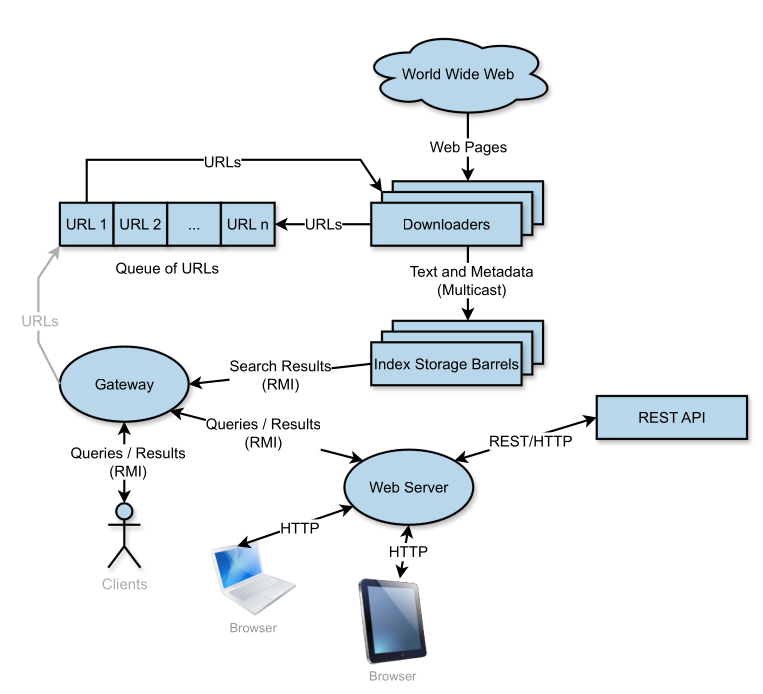

# Googol: Web Search Engine

## Index
- [Project Overview](#project-overview)
- [Project Requirements](#project-requirements)
- [Implementation](#implementation)
- [Repository Structure](#repository-structure)
- [Usage Instructions](#usage-instructions)

## Project Overview

This project aims to develop a web search engine. It is intended to provide a subset of the features offered by services such as Google.com and Bing.com, including automatic indexing (web crawler) and searching (search engine). The system stores various relevant details about each web page, including its URL, title and text snippet. When a user performs a search, the system should return a list of web pages containing the searched keywords, ranked according to their relevance. Users are also be able to submit URLs for indexing. Starting from these submitted URLs, the system should recursively or iteratively crawl and index all the links discovered on each page.

Googol is a distributed web search engine built using a client-server architecture. It features inter-server communication through Multicast sockets, remote data access using Java Remote Method Invocation (RMI), parallel data processing for improved performance, and redundancy to ensure application availability. The project also includes a web interface developed with Spring Boot, following the Model-View-Controller (MVC) architecture, with WebSockets for asynchronous client communication and integration with the Hacker News API through REST services.


- **Course**: Distributed Systems.
- **Technologies**: Java RMI, REST, WebSockets, AJAX, Spring Boot, Maven, Thymeleaf. 
- **Libraries**: Jsoup.

The conceptual architecture is presented and detailed below.



- **URL Queue** – Component that holds the URLs found by the Downloaders.

- **Downloaders** – Crawl the web pages from the **URL Queue**, send the data to **Index Storage Barrels** via multicast and push new urls into the **URL Queue**.

- **Index Storage Barrels** – Replicated storage that stores indexed data received from **Downloaders** via multicast.

- **RMI Gateway** – Serves **RMI Client** requests by fetching data from **Index Storage Barrels** via Java RMI.

- **RMI Client** – Queries the **RMI Gateway** to serve the Googol functionalities. Maybe interacted directly with or via the **Web Server**.

- **Web Server** - MVC server that queries the **RMI Gateway** via RMI to serve the Googol functionalities.

- **REST API** - Hacker News API, queried by the **Web Server** to search for key words and obtain the results URLs to be indexed.

## Project Requirements
### Functional Requirements
- Index new URL inserted by the user.
- Index iteratively or recursively the urls found.
- Search by pages containing key words.
- Search results are ordered by importance, prioritizing pages that are referenced by more other pages when multiple pages contain the searched keywords.
- Search the list of pages that point to a certain page.
- Index URLs of top stories from Hacker News that include the search keywords.
- Real time Administration page with the following data: 10 most common searches, active Barrels, mean response time per barrel measured by the gateway in (in tenths of a second).
- Search results batched in groups of 10.

### Fault Tolerance and Parallel Processing
- The information must be identical in all the storage barrels (reliable multicast implementation)
- The service must remain working even when there is the gateway and only 1 storage barrel.
- The barrels must recover the data lost during a crash.
- One barrel failure does not have visible impact on the client.
- Load balancing across searches on storage barrels.
- Downloaders execute in parallel.
- Gateway recovers from failures of barrels and downloaders.
- Indexing requests are handled by a single downloader (1 request per downloader).

## Implementation
### Downloader
- 3 blocking queues: received messages, outgoing messages, and missing acknowledgments.
- 5 threads:
    - The main thread crawls the URL popped from **URL Queue** and temporarily saves it the data locally in a HashMap (until acknowledged), the data is associated with a global ID counter fetched from the **RMI Gateway**. The data is inserted in the outgoing messages queue.
    - A thread to send messages of the outgoing messages queue to **Index Storage Barrels** via multicast. After sending a message it adds its ID to the missing acknowledgments queue together with a timestamp.
    - A thread that listens for received messages from **Index Storage Barrels** and inserts them in the received messages queue.
    - A thread that processes the acks from the received messages queue and removes the matching message with the id from the messages stored locally if not acknowledged already.
    - A thread that pops the contents of the missing acknowledgments queue and checks whether the ack was already received or not (if the message with the ID is still stored locally). If the message was not yet acknowledged and the time window for an acknowledgment is expired the message is inserted in the outgoing messages queue. If the message was not yet acknowledged but the timer is not yet expired then the thread will wait until the time window expires and recheck.

### RMI Gateway


### Index Storage Barrel
- 4 blocking queues: received messages, outgoing messages, data to be processed, and missing messages.
- 5 threads:
    - The main thread listens to new messages and inserts them in the received messages queue, also on boot the messages are loaded from storage and a discovery is request is sent via multicast to **Index Storage Barrels**.
    - A thread to send messages popped from the outgoing messages queue, which could be acks to **Downloaders**, message recovery requests to others **Index Storage Barrels** or even messages containing data as response to recovery/discovery requests from others **Index Storage Barrels**. 
    - A thread that pops the messages from the received messages queue and processes it according to its type:
        - If the message is from a downloader and unless it is already been saved, it is saved in memory and inserted in the data to be processed queue to be indexed in the barrel, an acknowledgment message to the **Downloaders** is also inserted in the outgoing messages queue. The message ID is also checked and compared against the number of contiguous messages received (i.e. latest message ID where the messages before form a complete sequence without holes), if a discrepancy is detected, recovery messages with the ID of the missing messages are inserted in the missing messages queue.
        - If the message is of the discovery type, the message with the highest ID received is inserted in the outgoing messages queue.
    - A thread that pops the messages from the "data to be processed" indexes and stores the data.
    - A thread that pops the contents of the missing messages queue and checks whether the message with the ID was already received or not. If the message was not yet received and the time window has expired, then the message is inserted in the outgoing messages queue. If the message was not yet received but the timer has not yet expired then the thread will wait until the time window expires and recheck.

## Repository Structure

``` text
.
├── .classpath
├── .gitignore
├── README.md
├── config
│   ├── clients.properties
│   ├── downloaders.properties
│   ├── index_storage_barrels.properties
│   └── rmi_gateway.properties
├── docs
│   ├── assignment_part1.pdf
│   ├── assignment_part2.pdf
│   ├── conceptual_arch.png
│   ├── javadoc
│   │   ├── allclasses-index.html
│   │   ├── allpackages-index.html
│   │   ├── com
│   │   │   └── ds
│   │   │       └── googol
│   │   │           ├── GoogolApplication.html
│   │   │           ├── WebSocketConfig.html
│   │   │           ├── controller
│   │   │           │   ├── PageController.html
│   │   │           │   ├── package-summary.html
│   │   │           │   └── package-tree.html
│   │   │           ├── model
│   │   │           │   ├── HackerNewsAPI.html
│   │   │           │   ├── PokemonAPI.html
│   │   │           │   ├── Server.html
│   │   │           │   ├── WebClient.html
│   │   │           │   ├── package-summary.html
│   │   │           │   └── package-tree.html
│   │   │           ├── package-summary.html
│   │   │           └── package-tree.html
│   │   ├── copy.svg
│   │   ├── element-list
│   │   ├── help-doc.html
│   │   ├── index-all.html
│   │   ├── index.html
│   │   ├── legal
│   │   │   ├── ASSEMBLY_EXCEPTION
│   │   │   ├── jquery.md
│   │   │   └── jqueryUI.md
│   │   ├── link.svg
│   │   ├── member-search-index.js
│   │   ├── meta1
│   │   │   ├── Downloader.html
│   │   │   ├── IndexStorageBarrel.html
│   │   │   ├── RMIBarrelsInterface.html
│   │   │   ├── RMIClient.html
│   │   │   ├── RMIClientsInterface.html
│   │   │   ├── RMIGateway.html
│   │   │   ├── RMIGatewayBarrelsInterface.html
│   │   │   ├── RMIGatewayClientsInterface.html
│   │   │   ├── RMIGatewayDownloadersInterface.html
│   │   │   ├── URLData.html
│   │   │   ├── package-summary.html
│   │   │   └── package-tree.html
│   │   ├── module-search-index.js
│   │   ├── overview-summary.html
│   │   ├── overview-tree.html
│   │   ├── package-search-index.js
│   │   ├── resources
│   │   │   ├── glass.png
│   │   │   └── x.png
│   │   ├── script-dir
│   │   │   ├── jquery-3.6.1.min.js
│   │   │   ├── jquery-ui.min.css
│   │   │   └── jquery-ui.min.js
│   │   ├── script.js
│   │   ├── search-page.js
│   │   ├── search.html
│   │   ├── search.js
│   │   ├── serialized-form.html
│   │   ├── stylesheet.css
│   │   ├── tag-search-index.js
│   │   └── type-search-index.js
├── not_web_server
│   ├── lib
│   │   └── jars
│   │       └── jsoup-1.17.2.jar
│   └── src
│       └── meta1
│           ├── Downloader.java
│           ├── IndexStorageBarrel.java
│           ├── RMIBarrelsInterface.java
│           ├── RMIClient.java
│           ├── RMIClientsInterface.java
│           ├── RMIGateway.java
│           ├── RMIGatewayBarrelsInterface.java
│           ├── RMIGatewayClientsInterface.java
│           ├── RMIGatewayDownloadersInterface.java
│           └── URLData.java
├── scripts
│   ├── client_runner.sh
│   ├── compile_all.sh
│   ├── downloader_runner.sh
│   ├── index_storage_barrel_runner.sh
│   ├── rmi_gateway_runner.sh
│   └── windows
│       ├── client_runner.cmd
│       ├── compile_all.cmd
│       ├── downloader_runner.cmd
│       ├── index_storage_barrel_runner.cmd
│       └── rmi_gateway_runner.cmd
└── web_server
    ├── .mvn
    │   └── wrapper
    │       ├── maven-wrapper.jar
    │       └── maven-wrapper.properties
    ├── lib
    │   └── jars
    │       └── meta1.jar
    ├── mvnw
    ├── mvnw.cmd
    ├── pom.xml
    └── src
        ├── main
        │   ├── java
        │   │   └── com
        │   │       └── ds
        │   │           └── googol
        │   │               ├── GoogolApplication.java
        │   │               ├── WebSocketConfig.java
        │   │               ├── controller
        │   │               │   └── PageController.java
        │   │               └── model
        │   │                   ├── HackerNewsAPI.java
        │   │                   ├── PokemonAPI.java
        │   │                   ├── Server.java
        │   │                   └── WebClient.java
        │   └── resources
        │       ├── application.properties
        │       ├── static
        │       │   ├── app.js
        │       │   └── main.css
        │       └── templates
        │           ├── admin.html
        │           ├── error.html
        │           ├── hacker_news_results.html
        │           ├── index.html
        │           ├── message.html
        │           ├── pokemon_page.html
        │           ├── pokemon_results.html
        │           ├── results.html
        │           └── search_or_add.html
        └── test
            └── java
                └── com
                    └── ds
                        └── googol
                            └── GoogolApplicationTests.java
```

## Usage Instructions
### Dependências
- É necessário um terminal Linux para correr os bash scripts.
- Pode ser que seja necessário fazer chmod dos scripts para que sejam possíveis de executar.
- As dependências do Maven estão contidas no [pom.xml](./web_server/pom.xml).
- Fora as dependências do Maven, o projeto precisa também de um jar do JSOUP ([jsoup-1.17.2.jar](./not_web_server/lib/jars/jsoup-1.17.2.jar)).

### Compilar

- Para compilar todos os ficheiros basta correr o script [compile_all.sh](./scripts/compile_all.sh), exemplo a partir da raíz do projeto "./scripts/compile_all.sh". Este script irá gerar também um jar que será necessário para o Maven correr.
- Este pode ser executado juntamente com um dos seguintes argumentos:
    - "-delete_bin_before_compile", apaga todo o conteúdo da pasta [bin](./bin), que contém todos os ficheiros binários, e depois compila.
    - "-delete_logs", apaga todos os ficheiros output de texto situados na pasta [logs](./logs) e depois compila.
    - "-clean_all", as duas opções anteriores combinadas.

### Execução
#### Ficheiros [downloader_runner.sh](./scripts/downloader_runner.sh), [index_storage_barrel_runner.sh](./scripts/index_storage_barrel_runner.sh)
- Ambos seguem a mesma base de execução.
- Exemplo da execução a partir da raíz do projeto: "./scripts/index_storage_barrel_runner.sh", sendo que neste caso será escolhido automáticamente um ID que corresponde ao número de nanosegundos dos sistema (é difícil mas não impossível que haja dois IDs iguais) e ficheiros de input e output default definidos no script.
- Caso se prenteda alterar o ID, poderá executar-se da seguinte forma: "./scripts/downloader_runner.sh 1" onde "1" é o ID.
- Ou então caso se queira alterar o ficheiro input de configuração (.config) e o ficheiro de output, deverá executar-se o script da seguinte forma: "./scripts/downloader_runner.sh 1 path_ficheiro.config path_ficheiro_output", onde 1 é o ID.

#### Ficheiro [rmi_gateway_runner.sh](./scripts/rmi_gateway_runner.sh)
- A execução é idêntica à anteriormente referida sendo que a única coisa que difere é que a RMIGateway não tem ID.

#### Ficheiro [client_runner.sh](./scripts/client_runner.sh)
- A execução é idêntica à dos ficheiros [downloader_runner.sh](./scripts/downloader_runner.sh) e [index_storage_barrel_runner.sh](./scripts/index_storage_barrel_runner.sh), à exceção que este não necessita de um ficheiro para o output.
